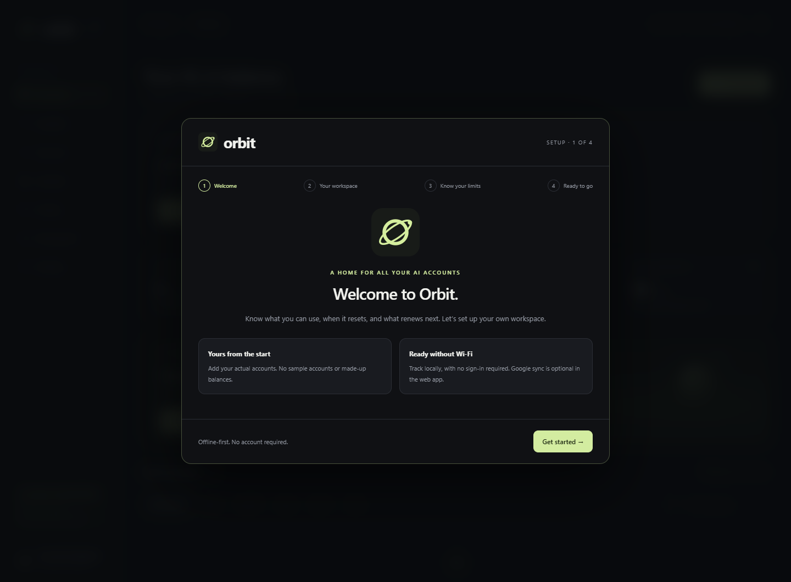
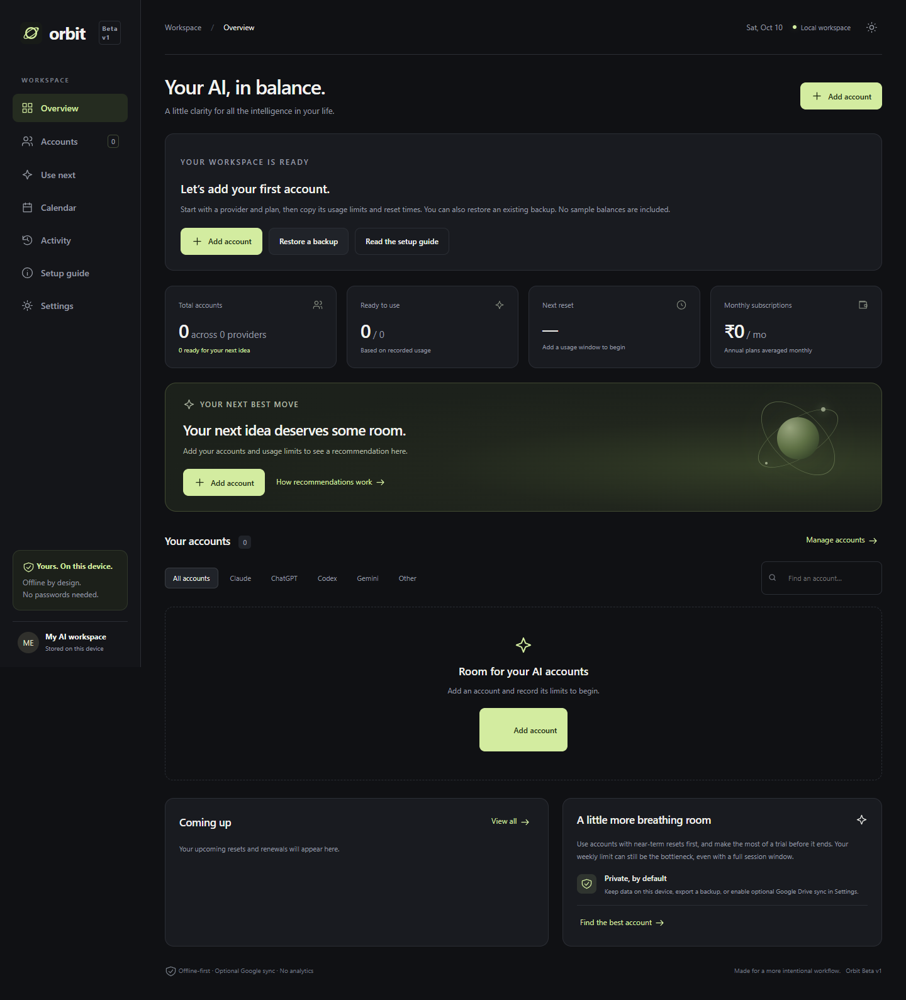
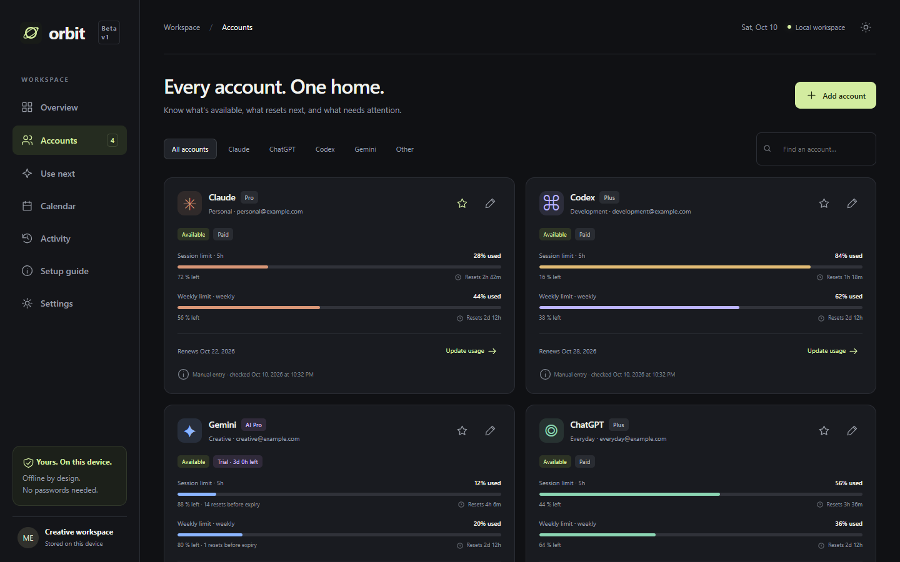
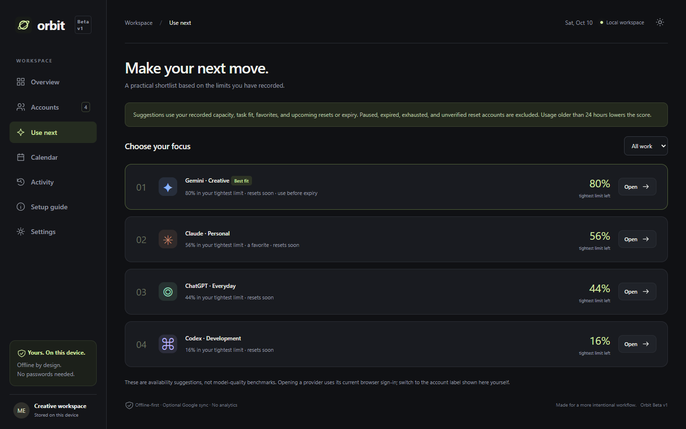
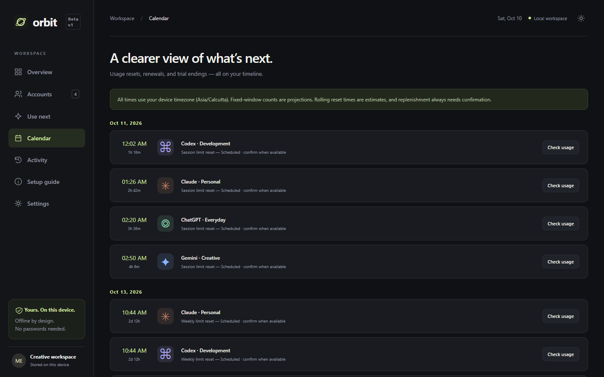

# Orbit

**Beta v1 · `1.0.0-beta` · Offline-first**

**[Download Orbit Beta v1](https://github.com/Francpaul-Thekkan/Orbit/releases/tag/v1.0.0-beta)** · Windows x64 installer or portable app · Android testing APK



An offline-first workspace for Claude, ChatGPT, Codex, Gemini, and custom accounts. Start with [START-HERE.md](START-HERE.md), or follow the startup guide built into the app.

Orbit helps you answer three everyday questions: **Which account still has room? When will it reset? What renews or expires next?** It brings your own account records together on one device. You can use it without signing in, then export a JSON backup whenever you want to move or protect your data.

> **Beta accuracy note:** Orbit records the usage, prices, and dates you enter. It does not read live balances from AI providers. The sample accounts shown in the promo video are illustrative and are not shipped in your workspace.

## At a glance

| What you need | Where Orbit helps |
| --- | --- |
| Several personal and work AI accounts | Keep each account separately labeled, even when the provider is the same. |
| A session limit and a weekly limit | Track both windows and see which one currently constrains the account. |
| Reset times that are easy to forget | See countdowns and upcoming events; confirm each real reset yourself. |
| Trials and subscriptions | Record tier, price, billing cycle, renewal, and expiry. |
| A choice of accounts for a task | Use **Use next** to compare recorded availability and task fit. |
| Offline access and device changes | Use bundled Windows/Android apps or a cached web app; export/import backups. |

## Fastest way to start

1. Download the Windows installer, Windows portable app, or Android APK from the **v1.0.0-beta** GitHub release. The filenames and platform details are below.
2. Open Orbit and finish the four-step setup. Give your workspace a name, choose a currency and theme, and start with the empty workspace.
3. Add one account. Copy the tier, billing dates, and usage limits from the provider's own account page.
4. Add a separate usage window for every quota you care about, such as a 5-hour session limit and a 168-hour weekly limit.
5. Return to **Update usage** when the provider shows a new balance. If a reset has happened, choose **Confirm reset** for that window.
6. Open **Use next** to see a shortlist for Coding, Writing, Research, General, or All work.
7. Export a backup from **Settings** before uninstalling, clearing storage, or changing devices.

You can read the same flow in more detail in [START-HERE.md](START-HERE.md). Setup stays available inside the app under **Settings → Startup setup**.

## Use the app

- **Windows x64:** download `Orbit-v1.0.0-beta-win-x64-setup.exe` to install, or open `Orbit-v1.0.0-beta-win-x64-portable.exe`. Both need no web server and are unsigned.
- **Android:** download `Orbit-v1.0.0-beta-android-debug.apk`. This is a development-signed APK for testing, not a Play Store release.
- **Web:** run `npm start`, then open `http://127.0.0.1:4173`. A hosted HTTPS version is also installable. Let its first load complete online before relying on offline mode.
- **iPhone/iPad:** open the hosted web version in Safari and use Share → Add to Home Screen. A native Xcode project is in `ios/App`.
- **macOS:** the shared Electron app supports macOS. Build a DMG on a Mac using `npm ci` and `npm run pack:mac`. Signing/notarization is not configured.

The first launch opens a four-step setup guide and creates an empty personal workspace. There are no demo accounts or sample balances. Choose your workspace name, currency, and appearance, then add an account or restore a backup. Existing accounts are preserved on upgrade. Back up before clearing app/browser storage or uninstalling.

Get the binaries from this repository's **Releases** page after publication.



## Features

- Multiple accounts per provider, arbitrary plan names, trial/paid/free status, favorites, and paused accounts.
- Up to eight independent usage windows per account: 5-hour, weekly, daily, or a custom period; credits, messages, percentages, or tokens.
- The most constrained window determines availability. Reset timers never silently replenish usage; confirm the provider's actual reset in Update usage.
- Fixed and rolling reset modes. Rolling times are estimates. Fixed windows show projected reset counts before access expiry.
- Renewal and expiry dates, monthly/annual pricing, multiple currencies shown separately without fabricated exchange rates.
- Task-aware recommendations based on recorded capacity, task fit, favorites, reset proximity, expiry, and data freshness.
- Calendar timeline, activity history, search/provider filters, dark/light themes, responsive layouts, reduced-motion support.
- Offline app caching, browser persistence request, JSON import/export, and native mobile backup sharing.
- Optional Google sign-in and Drive sync for browsers/installed web apps, with offline edits, conflict review, and a local recovery copy. See [GOOGLE-SYNC-SETUP.md](GOOGLE-SYNC-SETUP.md). A real OAuth client ID is required; it is not included.

## Screenshots

The images below use illustrative accounts and prices. A fresh installation opens with an empty workspace.

**Accounts:** compare session and weekly usage, status, billing, and upcoming resets.



**Use next:** pick a task and see a ranked shortlist from your recorded availability.



**Calendar:** review resets, renewals, and trial endings together.



## How usage tracking works

Each account can have up to eight independent windows. A window has a label, a duration in hours, a total limit, a used amount, a unit, a reset mode, and a next reset time. For example, if a provider displays a session allowance as a percentage, enter a total of `100`, `35` used, and `%` as the unit. A weekly limit is another window on the same account; use `168` hours for one week.

Orbit displays the remaining amount for each window and treats the tightest window as the account's current capacity. A full session allowance does not make the account available if its weekly allowance is exhausted. If a window is due to reset, Orbit marks it for verification instead of silently setting usage to zero. That prevents an estimate from looking like a provider-confirmed balance.

**Fixed** windows use the reset time you enter for countdowns and projections. **Rolling** windows can only have estimated reset times, because actual usage events may age out at different moments. Always follow the provider's displayed terms and reset time. Orbit cannot discover quota rules for you, and a provider may change them.

An account with no windows has unknown capacity. Paused, expired, exhausted, and reset-due accounts are left out of **Use next** until you review them. A favorite can influence ranking, but it cannot make an unavailable account available. Activity older than 24 hours lowers confidence in a recommendation. These suggestions describe **recorded availability and task fit**, not which AI model produces the best answer.

## Subscriptions, trials, and the calendar

For every account you can save a plan name, free/paid/trial status, cost, currency, monthly or yearly billing cycle, renewal date, expiry date, and auto-renewal setting. The overview averages annual costs into a monthly figure. It keeps different currencies separate; it does not guess an exchange rate.

The **Calendar** shows recorded reset, renewal, and trial-ending events in your device's timezone. If you record two accounts that are paid by one shared subscription, assign the cost to only one if you want an accurate spend total. Orbit does not automatically identify shared billing between ChatGPT, Codex, or other services.

There are no background notifications in Beta v1. The calendar and timers are visible while you use Orbit, and there is no guarantee that an external provider will reset exactly when your recorded time suggests.

## Offline use and data ownership

The Windows and Android packages contain the interface and can start without a web server. The browser/PWA needs one successful online load to cache its shell; after that, it can work offline as long as the browser retains the app's storage and cache. Data entered in one browser profile or packaged app does not automatically appear in another. Your data is kept locally until you export it or explicitly connect optional web Google sync.

**Backups are plain JSON.** They include account labels, optional email identifiers, notes, usage, billing information, and activity. Store them somewhere private. Importing a backup replaces the current workspace after confirmation, so export the existing one first if you might want it later. On Android, export uses the system share sheet. The Windows portable executable is portable, but the workspace remains in your Windows user profile; moving the executable alone does not move the data.

No AI account passwords or provider API keys are needed. Orbit is not affiliated with the AI services it helps you organize.

## Data and accuracy

This version uses **manual entries**, not live provider synchronization. No API keys or passwords are collected. Enter prices and limits from your own provider account. Orbit does not infer shared quotas or billing between ChatGPT and Codex; avoid counting one shared subscription twice.

Data is stored in the app's local Web Storage. Each browser, installed web app, and native app may have a separate workspace. Optional Google Drive sync uploads workspace versions only after you connect and choose Sync now; automatic sync while open is optional. Native Google OAuth is still pending, so native builds use export/import. No closed-app sync or notification system is implemented. JSON backups contain account labels, email identifiers, notes, usage, and activity in plain text. On mobile, the export opens the native share sheet. Import replaces the personal workspace after confirmation.

No hosted website is included with this release. Offline use relies on a successful initial load and retained browser storage; packaged desktop and mobile apps bundle their interface from installation. Android system backup remains enabled and follows device settings independently of Orbit's manual export. See [PRIVACY.md](PRIVACY.md) for data handling.

## Google sign-in and sync

Google sync is **optional** and currently available only in the browser and installed web app. It synchronizes Orbit's saved workspace through hidden Google Drive application data. It does **not** sign into Claude, ChatGPT, Codex, or Gemini for you, and it does not fetch usage from those services.

The app owner needs a Google Cloud project with Drive API enabled, an OAuth **web client ID**, configured consent screen/scopes, and exact authorized origins. No client secret goes into a public web app. Until these are configured, the downloadable native apps still work offline and can exchange JSON backups with the web version. Follow [GOOGLE-SYNC-SETUP.md](GOOGLE-SYNC-SETUP.md) for the full setup and Google source links.

When you connect in the web app, check the displayed Google email before the first **Sync now**. If both your device and Drive changed, Orbit asks which complete workspace to continue with. Export both copies first if you need to combine edits manually. It saves a local recovery copy before replacing local data. Older cloud versions remain in Drive; this beta does not compact or delete that history. Automatic sync can run while the visible web app is open, but never while Orbit is closed. A live Google OAuth/Drive round trip has not yet been verified with a real project, so validate it with your own client ID before depending on it.

## Common questions

<details><summary>Does Orbit update my usage automatically?</summary>

No. Open your provider's account page and enter the current amount in **Update usage**. Google sync transfers Orbit's records between web instances but is not a provider usage integration.

</details>

<details><summary>Why is an account missing from Use next?</summary>

Check that it has at least one usage window, is not paused or expired, has remaining room in every window, and has no reset due for verification. The list also changes when you select a task preference.

</details>

<details><summary>Why didn't a reset automatically restore my balance?</summary>

Orbit cannot verify whether the provider has actually reset the quota. Compare with the provider, then use **Confirm reset** for the affected window. A rolling reset time is only an estimate.

</details>

<details><summary>Will my data follow the Windows portable EXE?</summary>

No. The executable runs without installation, but its local workspace is saved under your Windows user profile. Export a JSON backup and import it on the other machine.

</details>

<details><summary>Can I use the APK on my phone today?</summary>

The release includes a development-signed Android APK. It was built successfully but has not been validated on a physical phone or emulator. It is a testing build rather than a store release. Export a backup before uninstalling or replacing it.

</details>

<details><summary>Why doesn't Google sign-in work in the desktop or Android app?</summary>

The current OAuth implementation is web-only. Native platform login needs its own client IDs and authorization flow. Use a browser/PWA for optional Google sync or move a JSON backup manually.

</details>

<details><summary>Can I use Orbit on an iPhone or Mac?</summary>

The hosted web app can be added to an iPhone home screen through Safari after someone publishes it over HTTPS. iOS and macOS source projects are present, but this beta provides no native IPA or DMG download and has no Apple-platform release validation.

</details>

<details><summary>What should I do before clearing storage or reinstalling?</summary>

Export a JSON backup from **Settings**, verify the file is saved somewhere you control, then make the change. Browser data clearing and app uninstall can remove the local workspace.

</details>

## Troubleshooting

| Symptom | What to check |
| --- | --- |
| **Reset due · verify** | Compare with the provider and confirm the specific reset in **Update usage**. |
| Usage seems older than expected | Check when it was last manually updated; Orbit does not poll provider accounts. |
| An account is absent from recommendations | Check all its windows, trial expiry, paused state, and task fit. |
| Monthly cost seems doubled | A shared subscription may be recorded on two accounts. |
| Browser app does not open offline | Complete one online load first, then retain site storage and service-worker cache. |
| Web update still shows an old shell | Close all Orbit tabs and reopen online. Do not clear storage without a backup. |
| Google connection is unavailable | Configure a public web OAuth client ID and the exact origin; see the Google setup guide. |
| Google sign-in works but devices disagree | Check the Google email, connection state, and any conflict prompt. Export both versions before choosing one. |
| Saved data cannot be parsed | Use the recovery export in Settings before clearing anything. |

If you report a bug, include the platform, build, steps to reproduce, and expected/actual behavior. Remove account names, email identifiers, backup contents, and OAuth tokens from public reports. Use the [issue templates](.github/ISSUE_TEMPLATE/) if you publish the repository.

## Development

Requires Node.js 22 or newer.

```sh
npm ci
npm run build
npm test
npm start
```

In another terminal, `npm run test:ui` runs the browser workflows against the local server. `npm run test:sync-ui` exercises two-device Google sync with mocked Google endpoints (no real login or Drive writes). `npm run test:desktop` tests Electron. The test scripts currently look for Chrome in its standard Windows location; adjust `executablePath` on another OS. QA uses isolated browser profiles and writes screenshots/results to the ignored `artifacts/` folder.

```sh
npm run desktop
npm run pack:win
npm run mobile:android
npm run mobile:ios
```

After changing the web source, rebuild the native bridge as needed and run `npx cap sync` before rebuilding mobile binaries. The UI source is already in `dist/`; only `scripts/native-bridge.js` needs bundling. Increment the cache name in `dist/sw.js` when distributing a new version of the web shell.

### Android

The included Android project uses Capacitor 8, Java 21, and Android SDK 36. Open it in Android Studio or use the Gradle wrapper:

```sh
npx cap sync android
cd android
./gradlew assembleDebug
```

On Windows, use `gradlew.bat`. Alternatively, run `powershell -File scripts/android-toolchain.ps1` from the repository root after `npm run mobile:android`. It downloads an isolated JDK/SDK into `artifacts/toolchain`, installs SDK packages, and builds an APK in `releases/` without replacing your system Java.

For production distribution, configure your own protected signing key and build a release APK/AAB. Do not commit signing keys or passwords.

### Apple platforms

Open `ios/App/App.xcodeproj` on a Mac with the supported Xcode version and choose a signing team to build/run on an iPhone. No native iOS binary or macOS DMG is supplied or validated. The manually triggered **Build Orbit apps** workflow prepares unsigned desktop and debug Android artifacts; it has not yet run on GitHub and does not publish releases or upload to stores.

### Web deployment and release version

Host `dist/` contents on an HTTPS static host. Assets use relative paths, including for repository subpaths. Follow the Google setup guide to configure your public client ID and origin before offering login to users. No backend is needed for local tracking.

The release is `1.0.0-beta`, displayed as **Beta v1**. Windows' numeric file/build version is `1.2.2` to remain newer than internal builds. Android uses version code `5`; iOS uses numeric marketing version `1.0.0`, build `5`. Storage keys remain unchanged.

## Structure

| Path | Purpose |
| --- | --- |
| `dist/app.js` | UI, local persistence, forms, backup workflows |
| `dist/domain.js` | Pure validation, usage math, ranking, reset logic |
| `dist/styles.css` | Responsive themes and motion |
| `dist/sw.js` | Versioned offline shell cache |
| `scripts/native-bridge.js` | Capacitor native share/filesystem/browser integration |
| `desktop/main.cjs` | Sandboxed Electron host, external URL allowlist |
| `android/`, `ios/` | Native mobile projects |
| `tests/domain.test.mjs` | Usage and backup edge-case tests |
| `GITHUB-PUBLISH.md` | Ready-to-copy GitHub fields and upload instructions |
| `RELEASE-NOTES.md` | Complete Beta v1 release description |

## Project information

See [BUILD-STATUS.md](BUILD-STATUS.md) for verification and remaining work, [CHANGELOG.md](CHANGELOG.md) for release history, and [CONTRIBUTING.md](CONTRIBUTING.md) for development guidance.

License selection is pending; no open-source license is currently supplied. Third-party dependencies retain their own licenses. Orbit is independent and is not affiliated with OpenAI, Anthropic, or Google.

## Platform references

- [Capacitor environment setup](https://capacitorjs.com/docs/getting-started/environment-setup)
- [Electron distribution](https://www.electronjs.org/docs/latest/tutorial/distribution-overview)
- [Android SDK tools](https://developer.android.com/tools/sdkmanager)
